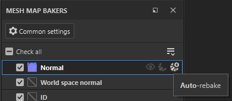

# 籠子繪畫

**籠子塗裝** 可以讓你在區域上色，將烘焙籠推得更遠或靠近低多邊形表面。 籠子繪製有助於防止烘焙時出現瑕疵，同時捕捉網格的高多邊形細節。

*左手套以距離為基礎的籠子和低最大正面距離烘烤，顯示烘焙異常，包括扭曲和籠子與高多邊形網格交會處，細節流失。 右手套是用同樣的設定烘烤的，但有籠子彩繪來控制籠子大小。*

>[!NOTE]
>
> 籠子塗裝會自動將籠子網格細分，這意味著即使是低解析度的網格，籠子也能被推拉到足以覆蓋所有細節。

## 準備凱奇繪畫

要讓 **Cage 繪製** 可用，專案必須至少有一個高多邊形場景檔案可供烘焙，且 Cage 類型必須設定為 **基於**&#x200B;距離。

>[!NOTE]
>
> 未來版本中，自動籠&#x200B;**子類型將新增**&#x200B;籠&#x200B;**子塗裝**&#x200B;支援。

我們建議在開始上漆籠子前，先設定 **最大正面距離** 和 **相對於包圍盒** 的數值，因為在上色後更改這些數值可能需要修飾，甚至從頭重新上色。

>[!TIP]
>
> 如果你想從頭開始籠子繪畫，請重設籠子繪畫參數、籠子繪畫筆觸，或是所有烘焙設定。
>
> 

## 開始籠子上色

開始上籠子畫作：

1. 切換到 [**烘焙模式**](baking.md)。
1. 請確保你至少選擇了一個 **高多邊形場景** 檔案來烘焙。
1. 在&#x200B;**「常見設定**&#x200B;**」面板**&#x200B;中，進入&#x200B;**籠子區塊**。
1. 將籠子類型&#x200B;**設**&#x200B;為&#x200B;**距離基礎**。
1. 點選 **「油漆籠**」。

>[!VIDEO](https://video.tv.adobe.com/v/3504611?learn=on)

*這段影片展示了一個新的籠子油漆計畫正在進行中。 首先切換到烘焙模式，然後選擇高多邊形場景。 預設選擇了基於距離的籠子類型，因此我們能立即開始籠子塗裝。*

>[!NOTE]
>
> 預設情況下，**當你第一次進入**&#x200B;籠子繪畫&#x200B;**時，正常通道會開啟自動重新烘焙**。這表示每次修改籠子時，法線貼圖都會自動重新烘焙。 在網格地圖烘焙面板中開啟&#x200B;**或關閉[**&#x200B;自動重新烘焙&#x200B;**。**](../interface/baking-panels/mesh-map-bakers.md)
>
> 

一旦進入籠子繪畫模式，視窗&#x200B;**中的**&#x200B;預設視覺化會顯示：

* 網格周圍的籠子是透明米色。
* 高多邊形與籠子交會的區域則用鮮紅色。
* 在低多邊形網格表面上，將區域以綠色（正片）和藍色（負片）繪製。

在籠子繪畫模式下，使用&#x200B;[**視窗**&#x200B;中的&#x200B;**烘焙視覺化選單**](baking-visualization-settings.md)，自訂每個元素的視覺化方式。

>[!NOTE]
>
> 高多邊形交叉點與籠子的鮮紅色視覺化只是大致預覽，與最終烘焙結果不完全吻合。 大多數情況下，視覺化相當準確，但對於多邊形又長且細的低多邊形網格，可能會不準確。 這些網格最好用 **快速烘焙** 或 **自動重新烘焙** 來檢查最終結果。

## 籠子塗裝工具

在上色籠子時，你可以使用許多你在繪畫模式中熟悉&#x200B;**的工具和快捷鍵，包括**&#x200B;畫筆&#x200B;**、**&#x200B;橡皮擦&#x200B;**和**&#x200B;多邊形填充&#x200B;**工具。**

* 你可以在工具列切換 **畫筆**、 **橡皮擦**&#x200B;和 **多邊形填充** ，或使用繪畫模式的標準 [鍵盤快捷鍵](../interface/settings/shortcuts.md) 。
* 使用&#x200B;**畫筆**&#x200B;或&#x200B;**橡皮擦**&#x200B;工具時，你可以透過視窗&#x200B;**頂部**&#x200B;的參數調整工具的大小、流線、透明度和間距。你也可以使用相關的 [鍵盤快捷鍵](../interface/settings/shortcuts.md) （如果有的話）。

### 畫筆

用 **畫筆** 調到最大 **強度**、 **流動** 度和 **透明度** ，對籠子表面影響很大。 我們建議設定非常低 **的強度** 值，並利用流動和不透明度參數來控制筆刷的強度。

*在這個例子中，第一筆筆觸即使強度值為0.05，也太強了。 降低力量、流動和划槳的不透明度後，我們對效果的控制力大大提升。*

### 橡皮擦

橡皮擦工具可以讓你從籠子上去除油漆，有效地將被抹除的區域恢復到預設籠子大小。

### 多邊形填充

在&#x200B;**籠子繪畫**&#x200B;**模式下**，**多邊形填充工具**&#x200B;還有一個額外功能，就是&#x200B;**在做修改時，視窗會出現**&#x200B;**一個強度滑桿**，可以用來調整最後一組選取多邊形的數值。

此功能對於在多個獨立網格場景中，使用 **網格填充模式** 進行每個元素的調整特別有用。

>[!NOTE]
>
> 此功能會以不同的強度值重演上一次的操作（多邊形填充）。 因此，執行不同操作或更換工具時，滑桿會消失。

通常將相同的籠狀繪製值套用到網格的多個區域會很有用。 要做到：

1. 選擇第一組多邊形。
1. 使用 **Cage 的強度** 滑桿來調整效果強度。
1. 從視窗&#x200B;**的臨時滑桿**&#x200B;複製&#x200B;**籠子強度**&#x200B;值。
1. 將數值貼到&#x200B;**視窗**&#x200B;頂端&#x200B;**的強度**&#x200B;滑桿中。
1. 選擇後續的多邊形集合以套用相同的強度值。

以下影片展示了這個工作流程的實際操作，使用&#x200B;**多邊形填充**&#x200B;**工具**&#x200B;並&#x200B;**選擇了網格填充**。

>[!VIDEO](https://video.tv.adobe.com/v/3504621?learn=on)

>[!NOTE]
>
> 依照這些步驟操作，選擇 **法線混合模式** 可能會有幫助，這樣多邊形填充工具會覆蓋現有的塗裝值，而不是往上加。

### 混合模式

預設情況下， **畫筆** 和 **多邊形填充** 工具都預設為 **線性閃避（新增）混合模式**，但你也可以使用 **法線** 和 **調亮（最大）混合模式**。

* **線性閃避（加法）**
  * 每一筆劃/印記都會從現有的強度值中加減。
  * 這個混合模式的運作方式類似 3D 雕刻應用程式，每一筆描繪都會加入網格表面。
* **正常**
  * 每一筆劃/印記都會將數值設定為指定的強度，覆蓋現有的數值。
  * 這個混合模式的行為就像繪畫模式下的預設畫筆，讓你可以用不同的數值覆蓋現有表面。
* **Lighten（Max）：**
  * 每一筆劃/印記都會選擇強度與現有值之間的最大值。
  * 在此混合模式中，筆尖的邊緣在後續筆觸中累積的時間較長，有助於創造更平緩的過渡。