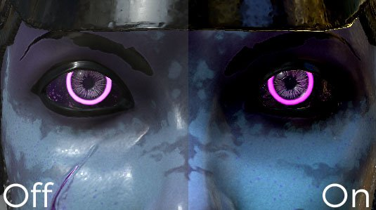

# 色彩校正

色彩校正參數：

| *背景設定* | *描述* |
| --- | --- |
| **飽和度** | 控制視窗中色彩的強度與飽和度。 用飽和度調到 0 來得到灰階渲染。 |
| **對比** | 控制明亮與深色的差異。 |
| **亮度** | 控制顏色的亮度與亮度。 |
| **偏壓** | 全域大小會抵消視窗的亮度。 |
| **棕褐色調比例** | 進階參數，讓視窗呈現棕褐色效果。 |
| **白平衡溫度（K）** | 顏色的溫度，以開爾文為單位。 預設是 6500K，對應白天光量。 [更多資訊](https://en.wikipedia.org/wiki/Color_temperature)請參閱維基百科。 |
