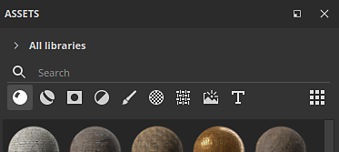
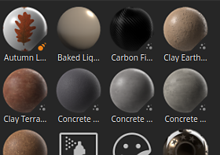

# 資產

資產視窗允許你存取應用程式內建的預設資源（稱為&#x200B;**起始資產**），以及任何[匯入的](https://helpx.adobe.com/substance-3d/unlisted/documentation/spdoc/adding-content-to-the-shelf-142213317.html)資源（這些資源可以在「你的資產&#x200B;**」中找到**）。

* 在磁碟上， **Starter 資產** 庫會儲存在應用程式的安裝資料夾中，而匯 **入 Your assets** library 的資產預設則位於 Documents 資料夾。
* 關於資產儲存在硬碟位置的更多資訊，請參閱 [「在硬碟](../../content/importing-assets/adding-content-on-the-hard-drive.md)上新增內容」。
* 也可以新增不同的圖書館位置。 為此，請參考 [「新增函式庫](adding-a-new-library.md)」。

## 概觀

資產視窗預設分為三個主要區塊：

1. 濾波器區域
1. 資產清單
1. 底部條

### 濾波器面積

更多資訊請參閱 [導航頁面](navigation.md)。

#### 資產列表

#### 底部欄

