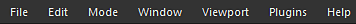

# 主選單

在工具列上方的主選單中，您可以存取管理專案、工作區，以及 Painter 的一般設定與資訊：

* [檔案選單](file-menu.md)
* [編輯選單](edit-menu.md)
* [模式選單](mode-menu.md)
* [視窗選單](window-menu.md)
* [視窗選單](https://helpx.adobe.com/tw/substance-3d/unlisted/documentation/spdoc/viewport-170460351.html)
* [插件選單](plugins-menu.md)
* [說明選單](help-menu.md)
