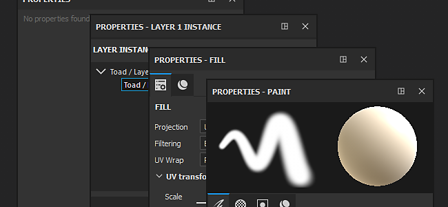

# 屬性

屬性視窗是可以修改工具、筆刷參數以及圖層屬性的地方。 屬性視窗可透過 [Dock 工具列](toolbars.md)或在&#x200B;**視窗選單[&#128279;](https://helpx.adobe.com/substance-3d/unlisted/documentation/spdoc/viewport-170460351.html)中右鍵點擊**&#x200B;進入。

關於可用參數及其功能，請參閱各工具與圖層的文件：

* [工具屬性](../painting/painting.md)
* [填充層屬性](../painting/fill-projections/fill-projections.md)
* [效果特性](../features/effects/effects.md)
