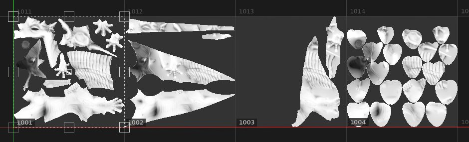

# 填充（以 UV 磚塊匹配）

**填充（以 UV 圖塊匹配）**&#x200B;是一種特殊的 2D 投影，對 UV 圖塊](../../features/uv-tiles/uv-tiles.md)專案非常有用[。它允許從序列中為每個 UV 圖塊指派 UDIM 貼圖。

這個投影沒有專門的設定，因為每個 UV 磚塊會被分配一張或多張圖片來填充。 由於沒有設定，這個模式在效能上也更好。

| 模式 | 說明 |
| --- | --- |
| **紫外線投影** | 所有 UV 圖塊會套用一張單一影像或序列中的第一個影像。 這同時也提供了變形控制，詳情請參見 [UV 投影](uv-projection.md) 。 

 |
| **填充（以 UV 磚塊匹配）** | 序列中的每個影像都會分配到專用的 UV 圖塊。 沒有變形控制。 

 |
