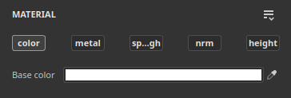

# 多邊形填充

**多邊形填充**&#x200B;工具會用材質通道值或灰階遮罩值填充多邊形。它可以用於塗裝圖層、特效和遮罩，快速填滿網格的區域。

這個工具比較像是繪畫工具，而不是選取工具：因此使用過後，只能透過橡皮擦工具或填滿來擦除。

此工具可從工具列中存取：

## 設定

以下是透過屬性視窗使用 **多邊形填充** 工具 **提供的設定** 清單。

### 選擇模式

選取模式控制網格幾何體中三角形和四邊形的選擇方式。

| **模式** | **描述** |
|---|---|
| **矩形招牌填充** | 點擊並拖曳繪製矩形選取。 **填充模式** 定義填充的幾何體，而 **Hit-test** 則定義包含哪些多邊形。    |
|   **多邊形迴路填充** | 只需一鍵，就能填滿一整個四邊形循環。 拖曳會選取多個迴圈。    |
| **部分多邊形迴路填充** | 點擊並拖曳來填滿迴圈的一部分。 選取可以沿著次要迴圈延伸，形成一組多邊形的斑塊。    |

### 填充模式

填充模式只能搭配 **矩形標記填充** 模式使用，控制幾何體的哪些部分被選取。

| **模式** | **描述** |
|---|---|
| **三角形填充** | 填充單一的網格三角形。 |
| **多邊形填充** | 填滿整個多邊形。 在匯入前三角剖分的網格，結果與三角形填充&#x200B;**相同**。 |
| **網格填充** | 填滿所有連接到點擊的多邊形。 |
| **UV 區塊填充** | 填充連接在 UV 空間中的多邊形。 填充會停止在紫外線邊界。 |

### 命中測試

命中測試設定控制三角形和四邊形如何被 **矩形標記填充** 模式選中。

| **模式** | **描述** |
|---|---|
| **交叉口** | （預設）如果多邊形的幾何體有任何部分位於選擇區域內或相交，則該多邊形即被填滿。 |
| **封閉式中心** | 只有當多邊形的中心點位於選取區域內時，該多邊形才會被填滿。 |
| **僅可見多邊形** | 啟用後，填充只會影響目前攝影機視角中可見的多邊形。 遮蔽和背面多邊形則被忽略。 如果關閉，多邊形可以穿過網格填充。 |

### 混合

這些設定控制填充結果如何與底層像素混合。

| **參數** | **描述** |
|---|---|
| 混合模式 | 控制填充如何與現有像素值混合。 在&#x200B;**材質**&#x200B;模式中，混合模式會套用到材質區段中啟用&#x200B;**&#x200B;**&#x200B;的所有通道。 |
| 不透明度 | 控制填充的透明度。 |

>[!NOTE]
>
> 該工具支援與圖層堆疊中相同的混合模式。 更多資訊請參閱 [混合模式文件頁面](https://experienceleague.adobe.com/en/docs/substance-3d-painter/using/interface/layer-stack/blending-modes)。

### 材質

材質區塊控制工具可啟用哪些通道可被繪製。

## 捷徑

多邊形填充工具可透過特定鍵盤快捷鍵有效使用：

| **捷徑** | **描述** |
|---|---|
| **替代** | 搭配 **多邊形迴圈填充** 和 **部分多邊形迴圈填色**，這個捷徑會在拖曳時將選取範圍延伸到初始點擊的另一側。    |
| **轉移** | 部分 **多邊形迴圈填充**&#x200B;時，這個捷徑只填滿主迴圈，忽略次迴圈。 切換 **Shift** 的範例：    |
| **Shift + A** | 此捷徑會暫時切換到 **其他選取模式的多邊形迴圈填充** 。 如果捷徑在滑鼠按鈕前先放開，選擇會持續直到滑鼠按鈕放開為止。 |
| **A** | 如果拖曳時按下這個捷徑，當前結果會與先前結果合併。 這在混合模式和不透明度上都有效：    |

## 限制

此工具存在一些限制：

* **多邊形迴圈填充** 和 **部分多邊形迴路填充** 只適用於四邊形，所以三角形和 n 邊形無法用這些模式填充。
* **徑向對稱** 支撐也有限且可能不可靠。 使用對稱模式時，建議使用鏡像模式。 更多資訊請參閱 [對稱性文件頁面](https://experienceleague.adobe.com/en/docs/substance-3d-painter/using/painting/symmetry/symmetry) 。
* 該工具僅從啟用的貼圖集&#x200B;**填充幾何**&#x200B;體。該材質集會顯示線框，並在該啟用材質集變更時更新。
