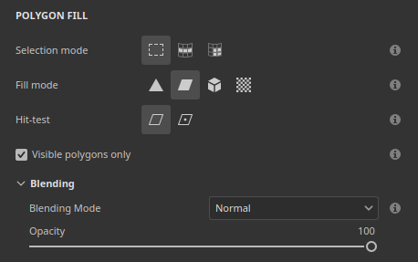

# 版本 12.2

**Substance 3D Painter 12.2** 帶來了改良版的多邊形填充工具，包含循環選取、籠狀繪製用於烘焙、視口中的貼圖集高亮，以及即時渲染的無序透明功能。

發行日期： **2026年10月21日**

## 主要特色

### 改良型多邊形填充

**多邊形填充**&#x200B;工具經過重新設計，新增了介面和多邊形迴圈的選取模式。此工具現在也支援帶有不透明度控制的混合模式，並能同時在多個聲道上運作。 選取功能同時處理遮蔽，也就是說隱藏在鏡頭外的多邊形會被忽略。

* **改良介面**

  **屬性視窗中的****多邊形填充**&#x200B;設定已重新調整，使其更易於使用。選項現在以按鍵排形式顯示，讓切換模式更為快速。 新的提示圖示說明了每種模式的運作方式。

  

* **新增選拔模式**

  選擇模式&#x200B;**列新增**&#x200B;了兩種專門用於多邊形迴圈的模式：

  

  * **多邊形迴圈填充**：此模式只需單擊即可填滿整個四邊形迴圈。 拖曳時按住 **Alt** 也會將選取範圍往相反方向延伸。

    

  * **部分多邊形迴圈填充**：此模式只填充迴圈的一部分，沿迴圈拖曳可擴展選取範圍。 拖曳時，箭頭會顯示選取範圍兩側的拓撲流動，以協助預測意外路徑變化。 游標旁的提示顯示兩個軸上選取的多邊形數量。 拖曳時按住 **Alt** 也會將選取範圍往相反方向延伸。

    

  按住 **Shift + A** 也會暫時切換到 **任意選取模式的多邊形迴圈填充** 。 如果捷徑在滑鼠按鈕前先放開，選擇會持續直到滑鼠按鈕放開為止。

* **填充模式切換選擇模式**

  **填充模式**&#x200B;選項不適用於&#x200B;**多邊形迴圈填充**&#x200B;和&#x200B;**部分多邊形環填充**&#x200B;模式。因此，選擇填充模式會自動將選取模式切換 **回主模式** 。

  

* **新的命中測試選項**

  新的 **Hit-test** 選項控制了選擇區包含哪些多邊形。 現在預設會丟棄非可見多邊形，因為 **預設是啟用了只顯示** 多邊形的選項。 關閉此選項後，填滿網格的行為會恢復。

  可用的選項包括：

  * **交集**：（預設）如果多邊形的任何部分位於選取區域內或穿越其邊緣，則該多邊形會被填滿。
  * **包含中心**：只有當多邊形的中心點位於選取區域內時，該多邊形才會被填滿。
  * **僅可見**&#x200B;多邊形：啟用此選項時，僅填充目前相機視角可見的多邊形。 因此，遮蔽與背面幾何形狀被忽略。

  

* **混合模式與不透明度**

  **多邊形填充**&#x200B;工具現在支援所有混合模式，與圖層堆疊中可用的列表相同。例如， **線性閃避（加法）** 是將數值加到現有的，而不是替換它們。 這些模式除了不透明度滑桿外，還可在屬性&#x200B;**視窗的新****混合**&#x200B;區塊中使用。****&#x200B;在&#x200B;**材質**&#x200B;模式中，混合模式會套用到材質區段中啟用&#x200B;****&#x200B;的所有通道。

  

* **同時填滿多個頻道**

  **多邊形填充**&#x200B;工具不再侷限於單一通道。現在可以在材質&#x200B;**區塊啟用的所有通道屬性**，只需一個動作就能設定並填滿。

  

* **與對稱性相容**

  **多邊形迴路填充** 和 **部分多邊形迴路填滿** 也適用於對稱性。 單點擊對鏡對稱是有效的（不過徑向對稱可能不太可靠）。

  

* **恢復上一次中風**

  **「繼續前一筆劃**」的快捷鍵（按住 **A** 鍵）現在可以搭配&#x200B;**多邊形填充**&#x200B;工具使用，涵蓋混合模式和透明度。

  

* **在材質集間更清晰的回饋**

  線框現在只顯示在活動中的材質集，當選取改變時線框也會更新。 從另一個材質集懸停幾何體時，現在會顯示禁用游標，表示相關幾何體無法被填滿。

  

>[!NOTE]
>
> 欲了解更多關於多邊形填充工具的&#x200B;**資訊，請參閱[專門的文件頁面](https://experienceleague.adobe.com/en/docs/substance-3d-painter/using/painting/paint-tools/polygon-fill)。**

### 烘焙模式中的新籠子彩繪

新的 **籠子繪製模式** 是每像素籠子偏移，可以在全域距離偏移上方繪製。 這表示籠子現在可以透過直接在網格上繪色來調整。 高多邊形網格延伸到籠子外的區域，則可以更容易在局部修復。

* **籠子偏移的新塗裝**

  烘焙模式中新增 **的「繪畫籠** 」按鈕現在會切換到籠子繪畫模式。 在此模式下 **，可以使用繪圖**、 **橡皮擦**&#x200B;和 **多邊形填充** 工具來調整籠子距離低多邊形網格的距離。

  

  這是透過繪製中間材質來完成的。 這個紋理會在烘焙時作為籠狀網格的偏移。 這與斜面繪畫&#x200B;**過程相似**。

  頂端工具列的 **Strength** 參數會設定筆觸所施加的偏移值。 同時也支援常見 **的大小**、 **流量**、 **筆劃透明度**&#x200B;和 **間距** 控制，以及 **反推值** 按鈕。 同時也支援對稱性。

  

  

* **使用 Polygon Fill 來選取並填滿整個網格部分**

  **多邊形填充**&#x200B;工具可以一次調整部分或完整子物件的籠子距離。點擊元素會開啟一個浮動工具列，裡面有 **籠子強度** 滑桿。 這個滑桿會根據上方工具列設定的值，即時調整籠子大小。 接著在偏移上塗上了油漆的偏移。

  

* **在視窗中視覺化籠子偏移**

  進入籠狀繪製模式會將視窗切換到新的視窗模式。 在此模式下，偏移會以綠色覆蓋在籠子上方可見。 籠子也會被變形，以代表烘焙過程中使用的籠狀網格。

  

  透過烘焙視覺化&#x200B;**面板可控制**&#x200B;部分設定：**籠**&#x200B;狀區塊控制&#x200B;**籠狀表面**&#x200B;與&#x200B;**籠線框**&#x200B;顯示及其不透明度。它同時具備 **偏移格子不透明度** 和 **偏移陰影強度**。

  

* **情境工具列中的混合模式**

  為了方便，有些混合模式直接在情境工具列內提供。 它們可以用來更輕鬆地調整籠子的偏移，特別是用來增加或減少偏移量。

  可用的模式包括：

  * **Normal**：將現有偏移量替換為筆劃值。
  * **減脂（最大值）：**&#x200B;保留筆劃較高值及現有偏移值。
  * **線性閃避（加法）：**（預設）將筆劃值加到現有偏移量上。

  

  透過多邊形填充&#x200B;**，可透過視窗中的右鍵選單進行**&#x200B;額外的混合模式。

* **籠子和斜線繪製的新重置選單**

  斜置和籠子塗裝模式現在都有新的選單可以重置設定。 可選方案如下：

  * **重置籠子/偏斜參數**：將 UI 參數重置為預設值。
  * **清除所有籠子/歪斜的油漆筆觸**：擦掉籠子或斜線繪畫所用的紋理。
  * **重置並清除所有**：結合重置介面和擦除籠狀/扭曲材質。

  

>[!NOTE]
>
> 想了解更多烘焙相關資訊，請參考 [專門的文件頁面](https://experienceleague.adobe.com/en/docs/substance-3d-painter/using/baking/baking)。

### 新材質集在視窗中高亮

新的高亮行為現在可以幫助辨識 3D 視窗中哪些幾何體與貼圖集&#x200B;**或** UV 圖塊&#x200B;**相關**&#x200B;聯。

* **材質集清單中的重點**

  在貼圖集列表中&#x200B;**滑鼠移至某個項目**&#x200B;時，現在會在視口中標示其幾何體，無論是貼圖集還是 UV 磚塊。這樣就能輕鬆看出網格中哪個部分屬於每個貼圖集。

  

* **從觀景窗拍攝的高光**

  按住 **Ctrl/Cmd + Alt** 在模型上，游標下方的貼圖集會高亮幾何體。 在按下左鍵或平移時，高亮會被隱藏，放開修飾鍵後又會恢復。

* **提供繪畫與烘焙模式**

  高光在上色和烘焙模式都能使用。 在烘焙模式下，已停用的貼圖集在高亮時會以灰色顯示。

### 新秩序無關的透明度

即時視窗現在支援與順序無關的透明度。 它消除了當多個透明或半透明表面重疊時可能出現的分類雜訊和閃爍現象。

* **顯示設定中的新選項**

  **可在顯示設定**&#x200B;的&#x200B;**渲染設定**&#x200B;區段啟用&#x200B;**「順序無關透明**」選項。預設是為避免影響效能而關閉的。

  

  啟用新設定前後：

  

* **效能控制**

  **排序容量**&#x200B;參數控制每個像素可排序的平均透明度層數。較高的數值能提升複雜場景中的透明度品質，但可能會佔用更多記憶體並降低效能。 可用的選項包括：

  * **低（1倍）。**
  * **中等（2次）。**
  * **高（4倍）（** 預設）
  * **非常高（8倍）**
  * **Ultra（16 次）**

### 其他改進

此版本新增了更多功能與改進：

* **重新整理顯示設定**

  顯示設定&#x200B;**視窗的**&#x200B;參數已重新組合並重新排序，面板更易於瀏覽。設定現在 **分為環境設定**、 **攝影機設定**、 **後期效果**、 **渲染設定**&#x200B;和 **視覺化設定**。 視窗頂端有一排按鈕，讓你能直接跳到每個群組。

  

* **筆觸的加色混合**

  刷子設定現在新增了加色混合模式。 此模式中，筆劃會在同一圖層上疊加，而非互相替換。 這不僅限於一筆劃內的郵票。 透過這個新模式，可以加色，或透過增加或移除數值來雕塑高度通道。

  

* **新的 UV 鄰居引擎貼圖**

  `mesh_uv_neighbor`新增了Substance材質與濾鏡的引擎地圖輸入。它作為 UV 平流貼圖，用來尋找 UV 島接縫的另一側。 其紅色和綠色通道儲存用來跨越 UV 接縫到達鄰近像素的紫外線對流。

  欲了解更多關於這些引擎貼圖的資訊，請參閱 [專門的文件頁面](https://experienceleague.adobe.com/en/docs/substance-3d-painter/using/content/creating-custom-effects/mesh-based-input)。

## 發行說明

### 12.2.0

即將推出。