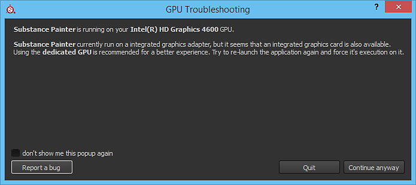

# 運行於整合式 GPU 上

{width="500px"}

有些電腦預設是用整合晶片組而非專用顯示卡。\
由於整合晶片組的效能非常低，我們建議改用專用 GPU。 彈出式罐子彈出並警告你。

使用 NVIDIA GPU 時，切換到 NVIDIA GPU 取決於應用程式配置檔。 如果應用程式沒有這樣的設定檔，你可以手動分配顯示卡：

1. 右鍵點擊桌面，選擇 NVIDIA 控制面板，  **或**  進入控制面板搜尋 NVIDIA 控制面板
1. 在 3D 設定&#x200B;**中**，請前往&#x200B;**管理 3D 設定**
1. 在程式設定&#x200B;**標籤**&#x200B;下新增 Substance 3D Painter 的設定檔&#x200B;****
1. 將首選顯示卡設定改為高效能 NVIDIA 處理器
