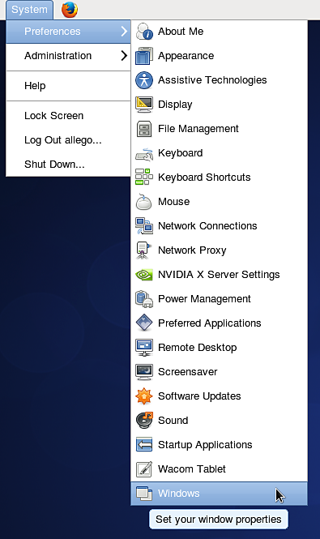
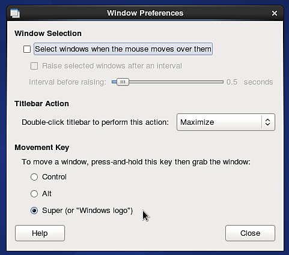

# Linux 上無法使用 ALT 鍵盤快捷鍵

如果你使用的是使用 Gnome **作為使用者介面的 Linux 發行版（** Ubuntu **或** CentOS **），你可能想關閉 ALT** 鍵的&#x200B;**預設行為，以便在視窗中導航。**

## CentOS

1 - 進入  **系統> Windows**

{width="250px"}

2 - 將「移動鍵」設定改成「Alt **」以外的**&#x200B;設定。例如使用「  **Super**  」（選擇鍵盤上的「Windows」鍵）。

{width="350px"}

## Ubuntu

1 - 開啟終端機並執行以下指令：

```
sudo apt-get install dconf-tools
```


這會安裝一個進階設定工具，你可能需要允許安裝額外的相依套件才能執行。

2 - 打開開始選單，尋找「  **Dconf-tools**  」。 發射。

3 - 透過以下路徑展開左側的樹狀選單：  **org > gnome > desktop > wm > 偏好設定**

4 - 編輯「滑鼠按鈕修飾符」並更改其值。 設定或代替，但  *不要空*  著。 Super 是相當於「Windows」鍵的等價物。

{width="500px"}
