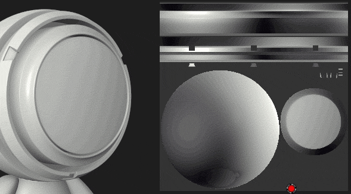

# Paint Tool 在其他 UV 島嶼上會滲色

在某些特定情況下，繪圖工具](../../../features/effects/paint.md)的預設行為[可能會顯得違反直覺。Substance 3D Painter 主要用於 3D 空間，這也適用於繪畫。 畫筆的預設設定是盡量在 UV 間無縫地畫畫。 這也是為什麼在與二維視角互動時，有些結果可能會讓人感到意外。

為了避免在 2D 視圖中繪製時其他 UV 島嶼出現出血問題，只要在工具參數中更改  **對齊**  設定：

| *對齊模式* | *預覽* |
| --- | --- |
| **切線包裹** | 

 |
| **紫外線** | 

 |
